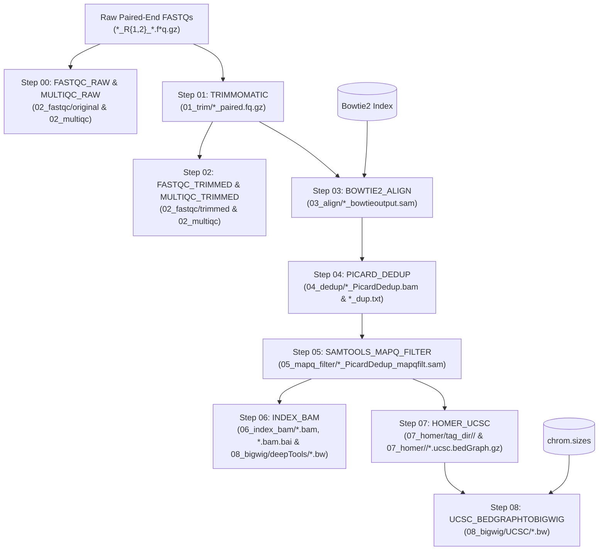

# CUT&RUN Upstream Base Pipeline (`cutandrun-base`)

[](https://www.nextflow.io/)
[](https://docs.conda.io/)
[](https://www.docker.com/)
[](https://sylabs.io/docs/)
[](https://www.nextflow.io/docs/latest/executor.html#lsf)

A modular **Nextflow DSL2** pipeline for upstream **CUT&RUN** paired-end sequencing processing—from raw FASTQ quality control and adapter trimming through alignment, duplicate removal, MAPQ filtering, BAM indexing, HOMER tag directory generation, and normalized BigWig track creation.

Designed for **UMass Chan HPC (LSF)** with native support for **Singularity/Apptainer**, **Docker**, **Conda/Mamba**, and environment modules (`-profile hpc`), and engineered to feed directly into the downstream [Cut_And_Run_Analysis](https://github.com/DanHUMassMed/Cut_And_Run_Analysis) peak-calling and motif discovery pipeline.

---

## Table of Contents

- [Pipeline Overview](#pipeline-overview)
- [Workflow Architecture](#workflow-architecture)
- [Key Features](#key-features)
- [Repository Structure](#repository-structure)
- [Requirements & Execution Profiles](#requirements--execution-profiles)
- [Quick Start](#quick-start)
- [Configuration Reference](#configuration-reference)
  - [Core Paths & Inputs](#core-paths--inputs)
  - [Step Toggles & Intermediate Fallbacks](#step-toggles--intermediate-fallbacks)
  - [Output Publishing Controls](#output-publishing-controls)
  - [Reference & Tool Parameters](#reference--tool-parameters)
  - [Samplesheet Format](#samplesheet-format)
- [Output Directory Structure](#output-directory-structure)
- [Testing & Stub Runs](#testing--stub-runs)
- [Authors & Citation](#authors--citation)

---

## Pipeline Overview

| Step | Process | Tool(s) | Published Directory | Description |
| :--- | :--- | :--- | :--- | :--- |
| **00** | `FASTQC_RAW` & `MULTIQC_RAW` | FastQC, MultiQC | `02_fastqc/original`, `02_multiqc` | Raw paired-end FASTQ quality control and aggregated MultiQC report |
| **01** | `TRIMMOMATIC` | Trimmomatic PE (`0.39`) | `01_trim` | Paired-end Illumina adapter (`TruSeq3-PE-2.fa`) and sliding-window quality trimming |
| **02** | `FASTQC_TRIMMED` & `MULTIQC_TRIMMED` | FastQC, MultiQC | `02_fastqc/trimmed`, `02_multiqc` | Post-trimming FASTQ quality control and aggregated MultiQC report |
| **03** | `BOWTIE2_ALIGN` | Bowtie2 | `03_align` | Paired-end alignment (`--very-sensitive -N 0 -X 500`) to reference genome |
| **04** | `PICARD_DEDUP` | Picard (`2.5.0`) | `04_dedup` | Coordinate sorting (`SortSam`) and duplicate removal (`MarkDuplicates`) |
| **05** | `SAMTOOLS_MAPQ_FILTER` | Samtools | `05_mapq_filter` | Low-quality alignment filtering (`samtools view -h -q 10`) |
| **06** | `INDEX_BAM` | Samtools, deepTools | `06_index_bam`, `08_bigwig/deepTools` | SAM-to-BAM conversion, `.bam.bai` indexing, and `bamCoverage` RPKM BigWig track |
| **07** | `HOMER_UCSC` | HOMER (`4.11`) | `07_homer` | `makeTagDirectory` and `makeUCSCfile` normalized `.ucsc.bedGraph.gz` track |
| **08** | `UCSC_BEDGRAPHTOBIGWIG` | UCSC `bedGraphToBigWig` | `08_bigwig/UCSC` | Coordinate-sorted bedGraph conversion to UCSC `.bw` BigWig track |

---

## Workflow Architecture



---

## Key Features

- **Per-Step Toggles with Automatic Intermediate Fallbacks:** Every processing stage (`run_raw_fastqc` through `run_ucsc_bigwig`) can be enabled or disabled independently in `config/experiment.config`. When an upstream step is turned off, the pipeline automatically resolves pre-existing intermediate files from `results/<experiment>/` (or custom `input_*` globs).
- **Separation of Code & Experiment State:** The pipeline repository stays clean and read-only while experiment-specific configs, logs, `work/` directories, and `results/` live in a dedicated experiment run folder (see [`docs/Example_Run`](docs/Example_Run)).
- **Selective Intermediate Publishing:** Control disk usage by toggling whether large intermediate SAM/BAM files (`publish_align_sam`, `publish_dedup_bam`, `publish_mapq_sam`) are copied to `results/` while keeping Picard duplication metrics (`*_dup.txt`) published.
- **0-Byte Placeholder Guard:** Automatically detects and skips 0-byte unhydrated Dropbox placeholder FASTQ files with a warning rather than failing mid-run.
- **Built-in Provenance & Telemetry:** Automatically generates Nextflow execution timeline, report, trace, DAG, and collated tool version YAML (`software_mqc_versions.yml`) in `results/<experiment>/pipeline_info/`.

---

## Repository Structure

```text
Cut_And_Run_Nextflow/
├── main.nf                         # Pipeline entrypoint, input channel resolution & validation
├── nextflow.config                 # Global default parameters, profiles, and reporting config
├── modules.json                    # Module metadata manifest
├── workflows/
│   └── cutandrun_base.nf           # Primary DSL2 workflow wiring Steps 00–08
├── conf/
│   ├── base.config                 # LSF executor defaults & process resource labels
│   └── modules.config              # Per-module ext.args and publishDir rules
├── assets/
│   └── adapters/
│       └── TruSeq3-PE-2.fa         # Bundled Illumina TruSeq3 paired-end adapter sequences
├── modules/
│   └── local/
│       ├── fastqc/                 # Step 00 & 02: FastQC module
│       ├── multiqc/                # Step 00 & 02: MultiQC aggregation module
│       ├── trimmomatic/            # Step 01: Trimmomatic PE adapter trimming
│       ├── bowtie2_align/          # Step 03: Bowtie2 paired-end alignment
│       ├── picard_dedup/           # Step 04: Picard SortSam & MarkDuplicates
│       ├── samtools_mapq_filter/   # Step 05: samtools view MAPQ filtering
│       ├── index_bam/              # Step 06: samtools BAM/BAI + deepTools bamCoverage
│       ├── homer_ucsc/             # Step 07: HOMER makeTagDirectory & makeUCSCfile
│       └── ucsc_bigwig/            # Step 08: UCSC bedGraphToBigWig conversion
└── docs/
    └── Example_Run/                # Template experiment directory (run.sh + config/)
```

---

## Requirements & Execution Profiles

- **Nextflow:** `>= 25.10.4`
- **Java:** `>= 17`
- **Compute Environment:** Default configuration targets an **IBM Spectrum LSF** cluster (`executor = 'lsf'`) with **Singularity** enabled by default. Use `-profile` to match your environment:

| Profile | Container / Package Engine | Executor | Description |
| :--- | :--- | :--- | :--- |
| *(default)* | Singularity (`autoMounts = true`) | `lsf` | Default HPC execution using Singularity containers on LSF queues (`short`/`long`) |
| `singularity` | Singularity | `lsf` | Explicit Singularity container profile |
| `apptainer` | Apptainer | `lsf` | Apptainer container profile |
| `hpc` | LSF Environment Modules | `lsf` | Uses cluster `module load` (`fastqc`, `trimmomatic`, `bowtie2`, `picard`, `samtools`, `deeptools`, `homer_env`, `ucsc_utilities`) without containers |
| `docker` | Docker | `lsf` / `local` | Runs processes in Docker containers with automatic volume mounts |
| `conda` | Conda | `lsf` / `local` | Builds per-module Conda environments from `modules/local/*/environment.yml` |
| `mamba` | Mamba | `lsf` / `local` | Uses Mamba for faster Conda environment resolution |
| `local` | Host PATH | `local` | Disables Singularity and runs processes locally on the host machine |
| `debug` | Inherited | Inherited | Enables hash dumping, prints `$HOSTNAME`, disables cleanup, and validates process names |

> [!TIP]
> Profiles can be combined with commas, e.g. `-profile local,docker` or `-profile local,conda` when running on a workstation without LSF.

---

## Quick Start

### 1. Create an Experiment Run Directory

Copy the template in [`docs/Example_Run`](docs/Example_Run) to set up a clean working directory for your experiment:

```bash
mkdir -p Experiment_Cut_Run_103026/Pipeline_Run
cp -r Cut_And_Run_Nextflow/docs/Example_Run/* Experiment_Cut_Run_103026/Pipeline_Run/
cd Experiment_Cut_Run_103026/Pipeline_Run
```

Your experiment directory will look like:

```text
Pipeline_Run/
├── config/
│   ├── experiment.config   # Experiment paths, step toggles, and tool parameters
│   └── samplesheet.csv     # Optional sample metadata mapping
├── data/
│   └── fastq/              # Place or symlink raw *_R1_*.fastq.gz and *_R2_*.fastq.gz here
└── run.sh                  # Wrapper script invoking Nextflow
```

### 2. Configure `config/experiment.config`

Edit `config/experiment.config` to set your experiment name, FASTQ input directory, and output path:

```groovy
params {
    email      = "your.name@umassmed.edu"
    experiment = "cut_run103026"
    fastq_dir  = "data/fastq"
    outdir     = "${launchDir}/results/${params.experiment}"
}
```

### 3. Run the Pipeline

Use the helper script `run.sh` (or call `nextflow` directly):

```bash
# Run on HPC with default Singularity + LSF settings
./run.sh

# Run on HPC using environment modules instead of containers
./run.sh -profile hpc

# Or invoke Nextflow directly
nextflow -c config/experiment.config run /path/to/Cut_And_Run_Nextflow -resume
```

---

## Configuration Reference

### Core Paths & Inputs

| Parameter | Default | Description |
| :--- | :--- | :--- |
| `params.experiment` | `null` *(required)* | Unique experiment identifier (e.g., `"cut_run103026"`) |
| `params.fastq_dir` | `null` *(required)* | Directory containing raw paired-end FASTQ files |
| `params.outdir` | `null` *(required)* | Output directory for published results (e.g., `"${launchDir}/results/${params.experiment}"`) |
| `params.samplesheet` | `"${launchDir}/config/samplesheet.csv"` | Optional CSV mapping `sample_id` to sample metadata |
| `params.email` | `null` | Notification email passed to `-N` by `run.sh` |
| `params.rclone_remote` | `null` | Optional `rclone` remote path for Dropbox staging/sync scripts |

### Step Toggles & Intermediate Fallbacks

Each pipeline stage can be toggled via boolean parameters. When a step is disabled (`false`) and a downstream step requires its output, the pipeline automatically reads existing files from the corresponding fallback glob:

| Step Toggle | Default | Fallback Parameter (when upstream step is `false`) | Default Fallback Glob |
| :--- | :--- | :--- | :--- |
| `run_raw_fastqc` | `true` | `input_fastq` | `"${params.fastq_dir}/*_R{1,2}_*.f*q.gz"` |
| `run_trimmomatic` | `true` | `input_fastq` | `"${params.fastq_dir}/*_R{1,2}_*.f*q.gz"` |
| `run_trimmed_fastqc` | `true` | `input_trimmed_fastq` *(if `run_trimmomatic = false`)* | `"${params.outdir}/01_trim/*_R{1,2}*_paired.fq.gz"` |
| `run_bowtie2_align` | `true` | `input_trimmed_fastq` *(if `run_trimmomatic = false`)* | `"${params.outdir}/01_trim/*_R{1,2}*_paired.fq.gz"` |
| `run_picard_dedup` | `true` | `input_align_sam` *(if `run_bowtie2_align = false`)* | `"${params.outdir}/03_align/*_bowtieoutput.sam"` |
| `run_mapq_filter` | `true` | `input_dedup_bam` *(if `run_picard_dedup = false`)* | `"${params.outdir}/04_dedup/*_PicardDedup.bam"` |
| `run_index_bam` | `true` | `input_mapq_sam` *(if `run_mapq_filter = false`)* | `"${params.outdir}/05_mapq_filter/*_PicardDedup_mapqfilt.sam"` |
| `run_homer_ucsc` | `true` | `input_mapq_sam` *(if `run_mapq_filter = false`)* | `"${params.outdir}/05_mapq_filter/*_PicardDedup_mapqfilt.sam"` |
| `run_ucsc_bigwig` | `true` | `input_bedgraph` *(if `run_homer_ucsc = false`)* | `"${params.outdir}/07_homer/*/*.ucsc.bedGraph.gz"` |

### Output Publishing Controls

| Parameter | Default | Description |
| :--- | :--- | :--- |
| `publish_dir_mode` | `'copy'` | Nextflow `publishDir` mode (`'copy'`, `'symlink'`, `'link'`) |
| `publish_align_sam` | `true` | Publish `03_align/*_bowtieoutput.sam` |
| `publish_dedup_bam` | `false` | Publish `04_dedup/*_PicardDedup.bam` (`*_dup.txt` metrics are always published) |
| `publish_mapq_sam` | `true` | Publish `05_mapq_filter/*_PicardDedup_mapqfilt.sam` |

> [!IMPORTANT]
> If you plan to re-run starting from Step 05 (`run_picard_dedup = false`, `run_mapq_filter = true`) after cleaning `work/`, set `publish_dedup_bam = true` during the initial run so `04_dedup/*_PicardDedup.bam` is available in `results/`.

### Reference & Tool Parameters

| Parameter | Default | Description |
| :--- | :--- | :--- |
| `trimmomatic_adapters` | `"${projectDir}/assets/adapters/TruSeq3-PE-2.fa"` | FASTA file of Illumina adapters for Trimmomatic `ILLUMINACLIP` |
| `trimmomatic_illuminaclip` | `"2:25:7:1:true"` | Trimmomatic `ILLUMINACLIP` seed mismatches, palindrome/simple clip thresholds |
| `trimmomatic_args` | `"SLIDINGWINDOW:4:10 TRAILING:3 MINLEN:10"` | Additional Trimmomatic quality trimming steps |
| `bowtie2_index` | `"/share/data/umw_biocore/genome_data/c_elegans/ce11_ws245/ce11_ws245"` | Path prefix or directory for Bowtie2 reference index |
| `bowtie2_args` | `"--very-sensitive -N 0 -X 500"` | Bowtie2 alignment flags |
| `chrom_sizes` | `"/share/data/umw_biocore/genome_data/c_elegans/ce11_ws245/ce11_ws245.chrom.sizes"` | Tab-delimited chromosome sizes file for `bedGraphToBigWig` |
| `picard_validation_stringency` | `"LENIENT"` | Picard `VALIDATION_STRINGENCY` setting |
| `picard_remove_duplicates` | `true` | Picard `REMOVE_DUPLICATES` boolean flag |
| `mapq_threshold` | `10` | Minimum MAPQ score retained by `samtools view -q` |
| `bamcoverage_norm` | `"RPKM"` | Normalization method passed to `bamCoverage --normalizeUsing` |
| `multiqc_module` | `""` | Optional LSF module name for MultiQC when using `-profile hpc` |

### Samplesheet Format

If `config/samplesheet.csv` is present, sample metadata is attached to each channel item (`meta`). If omitted or if a sample is not listed, `sample_id` is inferred automatically from the FASTQ filename prefix.

```csv
sample_id,sample_name,condition,target,replicate,control_id
L9254-0001-0001_S141_L004,EV_INT_H3K4me3,EV_INT_H3K4me3,H3K4me3,1,L9254-0001-0003_S143_L004
L9254-0001-0002_S142_L004,EV_INT_H3K27me3,EV_INT_H3K27me3,H3K27me3,1,L9254-0001-0003_S143_L004
L9254-0001-0003_S143_L004,EV_INT_IgG,EV_INT_IgG,IgG,1,
```

---

## Output Directory Structure

All outputs are written under `${params.outdir}` (typically `results/<experiment>/`):

```text
results/<experiment>/
├── 01_trim/
│   └── <sample>_R{1,2}_001_paired.fq.gz        # Trimmed paired-end FASTQ reads
├── 02_fastqc/
│   ├── original/                               # FastQC HTML & ZIP reports on raw reads
│   └── trimmed/                                # FastQC HTML & ZIP reports on trimmed reads
├── 02_multiqc/
│   ├── multiqc_original_report.html            # Aggregated MultiQC report (raw reads)
│   └── multiqc_trimmed_report.html             # Aggregated MultiQC report (trimmed reads)
├── 03_align/
│   └── <sample>_bowtieoutput.sam               # Bowtie2 alignments (if publish_align_sam = true)
├── 04_dedup/
│   ├── <sample>_dup.txt                        # Picard MarkDuplicates metrics
│   └── <sample>_PicardDedup.bam                # Deduplicated BAM (if publish_dedup_bam = true)
├── 05_mapq_filter/
│   └── <sample>_PicardDedup_mapqfilt.sam       # MAPQ-filtered SAM (if publish_mapq_sam = true)
├── 06_index_bam/
│   ├── <sample>.bam                            # Coordinate-sorted, deduplicated, MAPQ-filtered BAM
│   └── <sample>.bam.bai                        # BAM index
├── 07_homer/
│   ├── tag_dir/
│   │   └── <sample>/                           # HOMER tag directory
│   └── <sample>/
│       └── <sample>.ucsc.bedGraph.gz           # HOMER UCSC normalized bedGraph track
├── 08_bigwig/
│   ├── deepTools/
│   │   └── <sample>.bw                         # deepTools bamCoverage RPKM BigWig track
│   └── UCSC/
│       └── <sample>.bw                         # UCSC bedGraphToBigWig track (from HOMER bedGraph)
└── pipeline_info/
    ├── execution_report_<timestamp>.html       # Nextflow execution resource & status report
    ├── execution_timeline_<timestamp>.html     # Nextflow process execution timeline
    ├── execution_trace_<timestamp>.txt         # Tab-separated task trace log
    ├── pipeline_dag_<timestamp>.html           # Interactive workflow DAG visualization
    └── software_mqc_versions.yml               # Collated tool versions across all steps
```

---

## Testing & Stub Runs

Every module includes a `stub:` block so you can verify channel wiring, sample parsing, step toggles, and output publishing without running heavy bioinformatics tools:

```bash
nextflow -c config/experiment.config run /path/to/Cut_And_Run_Nextflow -profile local -stub-run
```

To inspect the resolved configuration values prior to submitting jobs:

```bash
nextflow -c config/experiment.config config /path/to/Cut_And_Run_Nextflow
```

---

## Authors & Citation

- **Author & Maintainer:** Dan Higgins (`@DanHUMassMed`) — UMass Chan Medical School (`daniel.higgins@umassmed.edu`)
- **Downstream Analysis Pipeline:** [DanHUMassMed/Cut_And_Run_Analysis](https://github.com/DanHUMassMed/Cut_And_Run_Analysis)
